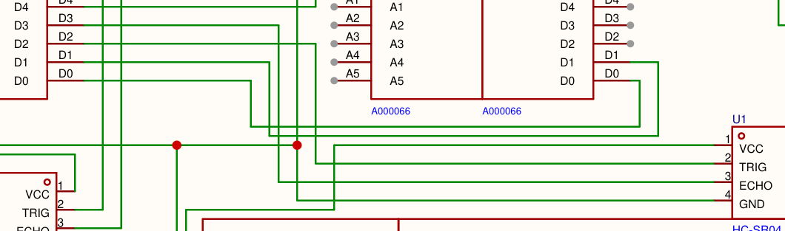
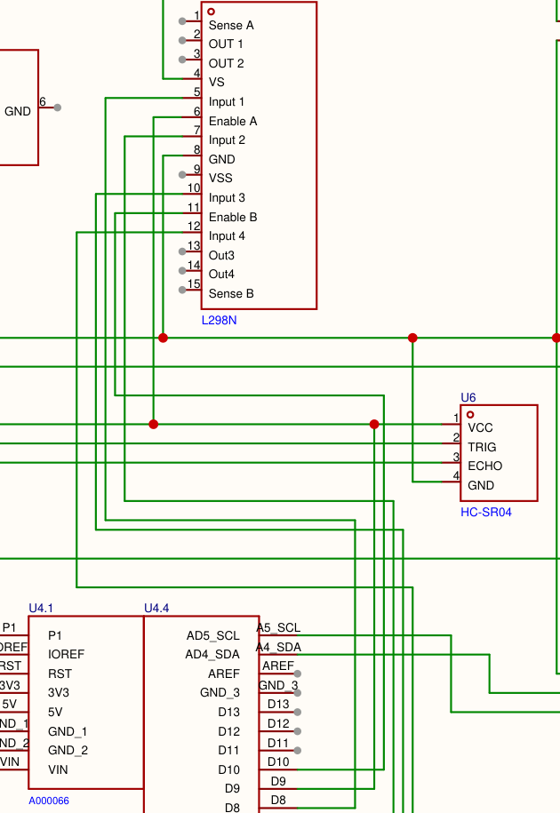

# Bitácora de programación

RoBorregos Candidates 2026, categoría Principiantes.

- **Programación:** Ahmed Jhulyam Corpus Venegas (A00845480)
- **Equipo:** [confirmar: nombre del equipo, capitán, quién lleva electrónica y quién mecánica]
- **Asesores:** [confirmar: nombres]
- **Repositorio:** https://github.com/Jhulyammm/candidates2026-programacion

> **Antes de entregar, borrar este recuadro.** Las entradas del 19 sep, 26 sep, 9 oct y 16 oct tienen archivos que las respaldan (están en `bitacora/`). Lo marcado con [confirmar] lo reconstruí sin evidencia escrita: corrígelo con lo que de verdad pasó o bórralo. El reglamento pide que podamos explicar y justificar la bitácora en las sesiones de seguimiento, y los asesores estuvieron ahí.

Una entrada por semana, desde la primera sesión con asesores. Cada una dice qué hice, qué decidí y por qué, la evidencia y qué sigue. El código está en esta misma carpeta (`robot/`, `motores/` y `simulador/`) y el `README.md` explica cómo correrlo.

## Resumen

| Semana | Qué pasó | Evidencia |
|---|---|---|
| 31 ago al 6 sep | Primera sesión con asesores. Conocimos al equipo y el reglamento. | [confirmar] |
| 7 al 13 sep | Dónde están los puntos y cómo explorar el laberinto. | [confirmar] |
| 14 al 20 sep | Propuesta de programación para la junta del 19 sep. | `bitacora/propuesta_programacion_2026-09-19.pdf` |
| 21 al 27 sep | Primer código, y un simulador que lo prueba sin robot. | `robot/`, `simulador/`, `README.md` |
| 28 sep al 4 oct | Llega el esquemático v1.0 de electrónica. | `bitacora/esquematico_v1.png` |
| 5 al 11 oct | Adapté el código a los dos Arduino del esquemático. | `bitacora/*_2026-10-09.*` |
| 12 al 18 oct | Electrónica cambió el esquemático: los Arduino se hablan por serial y hay LEDs. Primera prueba en el robot y el código en GitHub. | `bitacora/*_2026-10-16.*`, `bitacora/esquematico_*.png`, el repositorio |

---

## Semana 1: 31 ago al 6 sep. Arranque

### Viernes 4 sep. Primera sesión con asesores

Fue la primera vez que nos vimos con los asesores y entre nosotros. Nos presentamos, repasamos cómo funciona Candidates y quedamos en tener sesiones de seguimiento cada semana. [confirmar: qué día son las sesiones y cómo se repartieron los roles]

Para mí, como programador, lo importante fue el reglamento (versión del 28 de agosto). Hay cuatro reglas que cambian cómo se programa:

- **Pre-mapeo prohibido.** El robot no puede traer guardadas las paredes ni los colores de la pista. Todo lo tiene que aprender durante la ronda.
- El código tiene que ser nuestro. Se puede consultar documentación si se cita.
- Cada integrante tiene que poder explicar, modificar y justificar el algoritmo.
- Lo que entrega programación: el código en GitHub y esta bitácora.

**Siguiente:** leer el reglamento completo y empezar a pensar la estrategia.

---

## Semana 2: 7 al 13 sep. Estrategia [confirmar toda la semana]

Antes de pensar en código revisé dónde están los puntos (sección 4 del reglamento):

- En la pista A, **85 de los 130 puntos base son obstáculos** (topes, escaleras y rampa). Eso lo gana sobre todo la mecánica.
- En la pista B, **la pelota vale 110 de 240 puntos**. Sin garra el máximo es 130.
- Moverse exacto y leer colores da puntos en las dos pistas. La cámara del ArUco pide hardware extra y no le quita puntos a nada si no sale, así que va al final.

Después comparé dos formas de explorar el laberinto:

- **Seguir una pared** (siempre girar hacia el mismo lado). Es fácil de programar, pero no asegura pisar todas las casillas. Si una pared no toca la orilla del laberinto, el robot le da la vuelta y nunca entra a lo que queda en medio. Ahí puede estar un color o el rojo.
- **Búsqueda en profundidad (DFS) con una pila.** Visita todas las casillas a las que se puede llegar, y la pila le dice por dónde regresar cuando entra a un callejón.

Me quedé con el DFS. Lo vemos en Estructuras de Datos, y el mismo código sirve para buscar la pelota en la sección 1 de la pista B.

**Siguiente:** escribir la propuesta completa para presentarla al equipo.

---

## Semana 3: 14 al 20 sep. Propuesta de programación

### Sábado 19 sep. La propuesta, para la junta del equipo

Leí el reglamento completo y armé una propuesta todavía sin código, con diagramas de flujo y pseudocódigo de las dos pistas. La idea que la ordena: **el robot piensa en casillas**. Todo en las dos pistas mide 30 × 30 cm. Si el robot sabe avanzar exactamente una casilla y girar exactamente 90 grados, el problema deja de ser de física y se vuelve de estructuras de datos: una matriz para el mapa, una pila para regresar y una lista para el recorrido.

Lo que propuse:

- **DFS con pila** para el laberinto. El mismo explorador resuelve la sección 1 de la pista B.
- **Una lista con el recorrido** para el bonus 1 (regresar por el mismo camino). Basta con leerla al revés.
- **El rumbo como un número del 0 al 3.** Girar a la derecha es sumar 1 y a la izquierda restar 1, siempre módulo 4. Con eso seguir los colores de la sección 3 es una resta.
- **Calibrar el color en los 2 minutos de cada ronda** y decidir con 5 lecturas. No usé umbrales fijos porque el reglamento dice que los tonos pueden cambiar.
- **Después de un lack of progress, deducir la sección por el color del piso.** Así el robot no necesita recordar nada entre reinicios.

También salieron 6 preguntas para los organizadores (están al final).

[confirmar: qué se decidió en la junta]

**Evidencia:** `bitacora/propuesta_programacion_2026-09-19.pdf`

---

## Semana 4: 21 al 27 sep. Primer código y simulador

### Sábado 26 sep. La propuesta, pasada a código

Pasé la propuesta a C++ para Arduino. Como todavía no había robot, la decisión más importante fue cómo probarlo sin él.

**La lógica solo habla con un archivo, `hardware.h`.** Ahí está lo que la lógica le puede pedir al robot: avanzar, girar, leer una distancia, leer un color. Del otro lado puede estar el robot de verdad (`hardware_robot.cpp`) o una pista falsa en la computadora (`simulador/mundo.cpp`). Así probé las pistas del reglamento sin robot. Y si electrónica cambia una pieza, solo se cambia un archivo. Eso se cumplió dos semanas después (ver la semana 6).

El simulador sí conoce la pista completa, porque hace de "mundo real". El robot no: solo recibe lecturas de sensores. Al final el simulador compara el mapa que aprendió el robot contra el de verdad. Salió **96 de 96 lados bien** en los dos laberintos. Esa es la prueba de que no hay pre-mapeo.

Resultados con el robot a 15 cm/s, una velocidad supuesta:

| Prueba | Tiempo | Puntos |
|---|---|---|
| Pista A, laberinto de la imagen 1.1 | 4:32 | 165 de 195 |
| Pista A, un laberinto inventado | 4:19 | 140 de 195 |
| Pista B completa, imagen 2.1 | 1:52 | 240 de 240 |
| Pista B con las 4 posiciones de las paredes de la pelota | de 1:52 a 2:17 | 240 de 240 |

En la pista A faltan los 30 del ArUco, que no está hecho.

Al revisar la propuesta contra el reglamento y contra el simulador salieron 11 cambios. Dos los encontró el simulador, no yo:

- **La rampa se cruza completa.** En el laberinto inventado la rampa unía dos zonas que el robot ya conocía. El DFS se asomaba, veía la salida visitada y se regresaba sin cruzarla: perdía 20 puntos.
- **El bonus 1 se decide con el tiempo que ya se usó.** Con un número fijo de segundos por casilla, a 10 cm/s el robot empezaba el regreso y se le acababa la ronda a medio camino.

Otros salieron de leer el reglamento con más cuidado. La rampa tiene 30 cm planos arriba, y mi regla de "al volver a quedar plano cuenta 2 casillas" contaba mal. En la sección 2 el hueco entre líneas puede quedar a media altura (imagen 2.4). Y el verde sale en tres tonos. La lista completa está en el `README.md`, en "Qué cambió respecto a la propuesta".

Las preguntas para los organizadores pasaron de 6 a 9.

[confirmar: junta del 26 sep, qué se decidió]

**Evidencia:** `robot/`, `simulador/` y `README.md`

---

## Semana 5: 28 sep al 4 oct. Llega el esquemático

- **28 sep.** Electrónica actualizó el esquemático v1.0 en EasyEDA (es la fecha que trae el archivo). Lleva dos Arduino Uno, tres ultrasónicos, el sensor de color y el driver L298N.
- Semana de entregas del semestre. Decidí dejar la revisión del código para una sesión completa con el esquemático en mano, en lugar de ir adaptándolo a pedazos. [confirmar]

**Evidencia:** `bitacora/esquematico_v1.png`

---

## Semana 6: 5 al 11 oct. Adaptar el código al robot real

### Viernes 9 oct. Del Mega de ejemplo a los dos Uno del esquemático

El código del 26 sep suponía un Arduino Mega con encoders, IMU y pantalla. El esquemático es otro robot. Esto fue lo que hice, en orden.

**1. Leer el esquemático cable por cable.** Saqué las conexiones del PDF y las revisé una por una:

| Pieza | Arduino | Pines |
|---|---|---|
| Ultrasónico U1 | U2 | TRIG D2, ECHO D3 |
| Ultrasónico U5 | U2 | TRIG D9, ECHO D10 |
| Ultrasónico U6 | U2 | TRIG D5, ECHO D4 |
| Sensor de color | U2 y U4 | I2C (A4 y A5), con resistencias de 4.7 kΩ a 5 V |
| Driver L298N | U4 | ENA D9, IN1 D8, IN2 D7, ENB D10, IN3 D6, IN4 D5 |
| U2 con U4 | | I2C, y además D0 con D0 y D1 con D1 |

**2. Repartir el trabajo entre los dos Arduino.** La lógica va en U2, el de los ultrasónicos. ¿Por qué ahí? Un ultrasónico se mide con un cronómetro (`pulseIn`) en el mismo Arduino donde está conectado, y la lógica los lee todo el tiempo. A los motores, en cambio, basta con mandarles una orden cada pocos milisegundos. U4 quedó como un traductor: recibe "llanta izquierda a tanto, derecha a tanto" y se lo pasa al L298N. Su programa nuevo es `motores/motores.ino`.

**3. Cómo se hablan.** Por I2C, que ya estaba en el esquemático. U2 pregunta y U4 escucha en la dirección 8. Son dos órdenes: `M` con las dos velocidades (5 bytes) y `F` para frenar. Si U4 pasa 300 ms sin recibir nada, apaga los motores. Así, si U2 se reinicia o se zafa un cable, el robot se para en lugar de seguir avanzando contra una pared.

```cpp
// robot/hardware_robot.cpp: cada velocidad va en 2 bytes, primero el bajo
Wire.beginTransmission(ARDUINO_MOTORES);
Wire.write('M');
Wire.write(lowByte(izq));
Wire.write(highByte(izq));
Wire.write(lowByte(der));
Wire.write(highByte(der));
Wire.endTransmission();
```

**4. Moverse sin encoders ni IMU.** Sin encoders el robot no sabe cuánto avanzó, y sin IMU no sabe cuánto giró. Con tres ultrasónicos hice lo mejor que se puede:

- Si hay pared enfrente a menos de 70 cm, avanzar 10 cm es "que la pared quede 10 cm más cerca". Es más exacto que el reloj.
- Si hay pared a un lado, el robot trata de quedarse a la misma distancia de ella. Es lo que hacía el IMU: ir derecho.
- Los giros van por tiempo. Es lo más débil, y lo arregla un IMU.

Faltan tres números que solo se miden con el robot: los cm por segundo, los ms por grado y cuánto se carga hacia un lado. Cambian con la batería.

**5. Que cupiera en el Uno.** Compilé el código del 26 sep para Uno y **pedía 185% de la RAM**. El Uno tiene 2 KB y el Mega 8 KB. La mayor parte se la comían los textos de los mensajes: en el Uno cada texto entre comillas se copia a la RAM. Los dejé en la memoria de programa (que sobra) con una macro, `TXT("...")`. También quité la pantalla y el IMU, que no están en el esquemático, y recorté arreglos que eran más grandes de lo necesario. Quedó en **77% de la RAM y 63% de la memoria de programa**. El de motores usa 18%.

La RAM fija no es todo, porque cada función que se llama ocupa más mientras corre. Sumé lo que ocupa cada función en el programa compilado: el peor momento, el BFS imprimiendo un mensaje, pide unos 300 bytes de los 451 que quedan libres.

Para comprobar que no rompí nada, corrí el simulador con el código nuevo y con el del 26 sep: **las 199 líneas de salida salieron idénticas**.

**6. Lo que encontré en el esquemático.** Esto se lo paso a electrónica:

- **D0 va con D0 y D1 con D1.** En serial, lo que uno transmite (TX, D1) tiene que llegar a lo que el otro recibe (RX, D0). Además esos son los pines del USB: con ellos unidos, subir el programa puede fallar. Como el I2C ya los comunica, propongo quitar esos dos cables.
- El esquemático no dice qué ultrasónico quedó adelante. El código supone U1 adelante, U5 a la izquierda y U6 a la derecha.
- Si el L298N es el módulo rojo, hay que quitarle los jumpers de ENA y ENB para que D9 y D10 controlen la velocidad.
- Si el LM2596 es el módulo ajustable, hay que medir que dé 5.0 V antes de conectar los Arduino.
- Las resistencias del I2C van a 5 V y el sensor de color es un chip de 3.3 V. Hay que confirmar que el módulo tenga convertidor de nivel.



**7. Lo que le falta al robot para sacar todos los puntos.** Les dejé un pin propuesto a cada pieza en los pines libres de U2. Mientras no estén, el código no hace nada raro.

| Pieza | Sin ella |
|---|---|
| LED RGB | Pista A: se pierden los 20 puntos de color |
| Botón y selector | No hay cómo arrancar ni elegir la pista |
| Garra y sensor bajito | Pista B: 130 de 240 como máximo |
| Dos sensores de piso | En la sección 2, pisar una línea es lack of progress |
| IMU | Giros por tiempo; la rampa se cruza a ciegas |
| Encoders | El avance depende del tiempo y de la batería |

**Evidencia:** `bitacora/compilacion_uno_2026-10-09.txt` (antes y después), `bitacora/simulador_2026-10-09.txt`, `bitacora/esquematico_d0_d1.png`, y la sección "Adaptación al esquemático v1.0" del `README.md`.

**Siguiente:**

- Llevarle a electrónica la lista del punto 6 y las piezas del punto 7.
- Con el robot armado: confirmar qué ultrasónico quedó dónde y medir los tres números del punto 4.
- Mandar las 9 preguntas a los organizadores.
- Subir el código al repositorio de GitHub del equipo.

---

## Semana 7: 12 al 18 oct. Cambio de esquemático

### Viernes 16 oct. El esquemático del 15 oct

Electrónica actualizó el esquemático el 15 oct (`candidates schematic.pdf`; sigue diciendo V1.0, pero trae "Update at 2026-10-15"). Según electrónica, el cambio fue para que cada Arduino tuviera sus propios sensores.

**1. Qué cambió.** Volví a sacar las conexiones del PDF y las comparé con las del 9 oct:

| Pieza | 9 oct | 15 oct |
|---|---|---|
| Sensor de color | uno, en el I2C de los dos Arduino | dos, uno en el I2C de cada Arduino |
| U2 con U4 | I2C, y además D0 con D0 y D1 con D1 | serial: el D1 de cada uno al D0 del otro |
| Resistencias de 4.7 kΩ | subían el I2C a 5 V | una por LED, a GND |
| LEDs | no había | tres, en D4, D3 y D2 de U4 |
| ENA del L298N | a D9 de U4 | a D9 de U4 **y a 5 V** |

Los ultrasónicos y los demás pines del L298N quedaron igual.

¿Por qué dos sensores de color separados? El TCS34725 tiene una dirección I2C fija (0x29). Si dos van en los mismos cables, el Arduino no sabe a cuál le habla. Por eso cada uno quedó en su Arduino, los Arduino dejaron de compartir el I2C y tuvieron que hablarse por serial. Dos puntos de la lista que le pasé a electrónica el 9 oct ya quedaron: D0 y D1 ahora van cruzados bien, y ya no están las resistencias que subían el I2C a 5 V.

**2. De I2C a serial.** El problema: en el Uno, el serial de D0 y D1 es el mismo del USB. Por el cable que va a U4 también salen los mensajes de texto que imprimo para saber qué hace el robot. U4 tiene que distinguir una orden de un texto. La solución: cada orden empieza con el byte 255, que nunca aparece en un texto, ni siquiera en las letras con acento. Lo que llega entre una orden y otra se ignora.

```cpp
// robot/hardware_robot.cpp: cada velocidad en un byte, de 0 a 254 (127 = parado)
Serial.write(INICIO);    // 255
Serial.write('M');
Serial.write(velocidadEnByte(izq));
Serial.write(velocidadEnByte(der));
```

Para que ningún dato valga 255, cada velocidad va en un solo byte: la mitad, más 127. Se pierde la mitad de la precisión (va de 2 en 2), y un motor no lo nota. Sigue igual lo de los 300 ms: si U4 no recibe órdenes, apaga los motores.

**3. Los LEDs.** Están en U4, así que U2 le manda una orden más, `L` con el número del color, y U4 los prende. Los traté como rojo, verde y azul. El verde quedó en D3 porque es el único de los tres pines con PWM, y el naranja necesita el verde a medias.

**4. Comprobarlo sin robot.** Hice una prueba (`simulador/prueba_motores.cpp`) que compila el `motores.ino` de verdad con un Arduino falso y le mete texto con acentos revuelto con órdenes, órdenes cortadas a la mitad y silencio. Pasa las 15 revisiones. Para saber si la prueba de verdad detecta errores, la corrí contra copias de `motores.ino` con un error puesto a propósito. La primera vez no lo detectó: quité la línea que ignora el texto y nada falló, porque la prueba no revisaba que el texto se escribiera fuera del arreglo de datos. Agregué esa revisión y ahora sí lo detecta.

También corrí el simulador: las 199 líneas salieron idénticas a las del 9 oct, así que la lógica de las pistas no cambió. Compilado para Uno, el de sensores quedó en 77% de RAM (471 bytes libres) y el de motores en 11%.

**5. Lo que encontré en el esquemático nuevo.** Esto se lo paso a electrónica:

- **Urgente: el cable de ENA quedó encimado sobre la línea de 5 V.** Sigue la misma ruta que en el esquemático anterior, pero su tramo horizontal cayó justo encima de la línea de 5 V que va al ultrasónico U6, y EasyEDA los unió. Si se cablea así, D9 de U4 queda conectado a 5 V y se quema la primera vez que el programa lo ponga en bajo. El código sigue mandando ENA a D9.
- **Los tres LEDs son rojos.** Con LEDs rojos no se puede mostrar cian, amarillo, naranja ni rosa, que son los colores de la pista A (20 puntos). Tienen que ser rojo, verde y azul, o uno RGB.
- **Con 4.7 kΩ los LEDs casi no se ven** (menos de 1 mA). Con 220 Ω quedan entre 8 y 14 mA.
- **¿Para qué es el segundo sensor de color?** El código no lo usa hasta saberlo.



**6. La versión final.** Les pasé las preguntas a electrónica y ese mismo día mandaron `Candidates_esquematicofinal.pdf`. Me contestaron que los dos sensores de color son para tener más precisión, que la garra funciona con un servo normal y que no tenemos botón ni switch: estamos viendo poner un switch abajo de la garra para arrancar y otro para elegir la pista. Ya no tiene cables largos: cada patita lleva una etiqueta, y las patitas con el mismo nombre quedan conectadas. Por eso revisé que cada etiqueta de señal apareciera exactamente dos veces y escrita igual, porque una letra distinta desconecta sin que se note. Las conexiones son las mismas del 15 oct y **el cable de ENA ya va solo a D9**. El código no cambió. Siguen faltando el botón, el switch, la garra, los sensores de piso y los motores, y los LEDs siguen siendo rojos con 4.7 kΩ.

**Evidencia:** `bitacora/esquematico_2026-10-15.png`, `bitacora/esquematico_ena_5v.png`, `bitacora/esquematico_final_2026-10-16.png`, `bitacora/compilacion_uno_2026-10-16.txt` (antes y después), `bitacora/prueba_serial_2026-10-16.txt`, y la sección "El robot del esquemático (15 oct)" del `README.md`.

**Siguiente:**

- Que electrónica agregue el botón y el switch: sin botón el robot no arranca.
- Cambiar los LEDs por rojo, verde y azul, con resistencias de 220 Ω.
- Decidir con el equipo para qué es el segundo sensor de color.
- Antes de subir un programa, desconectar el cable de D0 del Arduino que se va a programar.

### Viernes 16 oct, más tarde. El diseño de mecánica

Revisé el código contra lo que armó mecánica: el instructivo de armado y el modelo 3D. El instructivo no trae pines, pero el modelo 3D trae la posición de cada pieza, así que saqué las medidas de ahí y se las puse al simulador una por una, para ver cuánto pesa cada diferencia.

**Lo que corregí en el código:** el robot no tiene sensor bajito; la pelota se detecta cuando entra al pocket y aprieta un micro switch. El código la buscaba con el sensor bajito, y sin él, en el simulador, la pista B bajaba de 240 a 130. Ahora en la sección 1 explora con la compuerta abierta, y cuando el switch se aprieta la cierra. Volvió a 240 de 240 en las cuatro posiciones de la pelota. También ajusté el largo del robot (24 cm) y los nombres: la garra es una compuerta con un servo SG90.

**Lo que no se arregla en el código:** los dos sensores de color van casi en el centro del robot (1.2 cm adelante), y mi estrategia necesita que vayan unos 8 cm adelante para leer la casilla de enfrente sin pisarla. Con las medidas reales, la pista A bajó de 165 a 110 en el simulador. Además, el ultrasónico de enfrente queda a menos de 2 cm de la pared cuando el robot está centrado, el robot casi no cabe girando en una casilla, no hay sensores de piso para la sección 2 y la batería 3S puede ser mucho voltaje para los motores TT. Se lo pasé a mecánica con los números. Ya no hay tiempo de cambiar la mecánica, así que decidimos dejarla como está y adaptar la estrategia en el código.

**Evidencia:** `bitacora/simulador_2026-10-16.txt` y la sección "El robot de mecánica (16 oct)" del `README.md`.

### Viernes 16 oct, en la noche. Primera vez en el robot

Subí los dos programas a los Arduino. Al subir el de motores salió "not in sync": el otro Arduino estaba mandando datos a su D0 mientras se subía el programa. Desconectando ese cable, subió.

En el monitor serial salió esto:

- **Letras revueltas.** Primero pensé que eran los bytes de las órdenes (el 255 de inicio y el 0 del color blanco), y cambié las órdenes a puro texto: empiezan con `~` y los números van en hexadecimal (`~M7F7F`). Las letras revueltas siguieron saliendo con el cable entre los Arduino conectado, así que esa no era la causa. Leyendo el puerto directo desde la computadora, sin el monitor del IDE, los bytes llegaban limpios. La causa exacta no quedó clara; el cambio a texto se quedó porque así las órdenes se pueden leer. La prueba del serial pasa sus 17 revisiones y detecta los dos errores que le metí a propósito.
- **"No encuentro el sensor de color".** El Arduino de sensores no ve el TCS34725 por I2C. Agregué al modo de pruebas la letra `i`, que dice qué hay conectado al I2C: salió "Nada en el I2C". Revisamos la alimentación y los cables y sigue sin aparecer; está pendiente.
- **Arrancó a calibrar la pista B,** o sea que D12 estaba en GND. D12 es el selector de pista; quedó como un cable dupont: a GND corre la B y suelto corre la A.

También hice un modo de pruebas (`robot/pruebas.cpp`) para medir el robot de verdad: los sensores, el avance, los giros, la compuerta y los LEDs, y cada prueba dice qué número cambiar.

Lo que cambió en las conexiones esa noche:

- **El servo pasó del D11 del Arduino de motores al D7 del de sensores.** La librería Servo usa el mismo temporizador que la velocidad de D9 y D10, y en el de motores esos dos son ENA y ENB: los motores habrían perdido el control de velocidad.
- **Quité el cable de regreso** (D1 de motores al D0 de sensores). Solo servía para que el de motores contestara "aquí estoy", y mientras está puesto no se puede subir el programa ni entrar al modo de pruebas.
- **No hay botón:** el botón de arranque es el mismo micro switch de la pelota (A3), apretado con el dedo.
- **Diagnóstico de cables.** Agregué al modo de pruebas `u`, que dispara cada ultrasónico y busca en qué pin contesta el eco, y `w`, que dice qué pines están en GND. El de la izquierda funciona siempre; el de la derecha funcionó en una vuelta y en la otra no (falso contacto); el de enfrente no contesta en ningún pin. Además D11 aparece en GND sin que debiera tener nada. Sigue pendiente.

**El código en GitHub.** Subí el código y esta bitácora al repositorio del equipo: https://github.com/Jhulyammm/candidates2026-programacion. El script `armar_entrega.py` (en la carpeta del proyecto) arma la carpeta de entrega y los zips de cada Arduino a partir de `codigo/`, y esa carpeta es la que se sube al repositorio cada vez que cambia algo.

---

## Decisiones y por qué

| Fecha | Decisión | Por qué |
|---|---|---|
| 19 sep | Pensar las pistas como cuadrícula de casillas de 30 cm | Convierte el problema en estructuras de datos: matriz, pila y lista |
| 19 sep | DFS con pila, no seguir una pared | Pisa todas las casillas; seguir la pared puede dejar zonas sin ver |
| 19 sep | Calibrar colores en cada ronda y votar entre 5 lecturas | Los tonos cambian de pista a pista |
| 26 sep | La lógica solo habla con `hardware.h` | Probar sin robot; cambiar una pieza toca un solo archivo |
| 26 sep | Simulador que corre la misma lógica | Encontró 2 errores que leyendo no vi |
| 26 sep | La calibración se guarda en la EEPROM | Sobrevive al reinicio de un lack of progress. Son tonos, no posiciones: no es pre-mapeo |
| 9 oct | La lógica en el Arduino de los sensores | El ultrasónico se mide en el Arduino donde está conectado |
| 9 oct | Avanzar midiendo contra la pared de enfrente | No hay encoders |
| 9 oct | Los textos en la memoria de programa | El Uno tiene 2 KB de RAM y el código pedía 185% |
| 16 oct | Cada orden por serial empieza con un 255 | Por el mismo cable llegan los mensajes de texto, y el 255 nunca sale en un texto |
| 16 oct | ENA sigue yendo a D9 | El cable a 5 V parece un error de dibujo, y cableado así quemaría el pin |
| 16 oct | La pelota se detecta con el micro switch del pocket | El robot de mecánica no tiene sensor bajito; sin este cambio, la pista B bajaba a 130 |
| 16 oct | No mover `SENSOR_COLOR_ADELANTE` a la medida real | Con 1.2 cm la estrategia de asomarse no funciona: se decide con mecánica |

## Preguntas para los organizadores

1. Bonus 1: ¿"el mismo camino" incluye las casillas de los callejones?
2. ¿Pisar el rojo antes de terminar de explorar acaba la ronda?
3. Sección 2: ¿las líneas siempre van en las divisiones entre casillas? ¿Hay paredes alrededor?
4. ¿Se pueden usar librerías de sensores (Adafruit TCS34725 y Servo) y OpenCV para el ArUco?
5. ¿Cuánto tiempo tiene que verse el color en el LED?
6. ¿De qué color es el piso del laberinto y de la sección 1? ¿La sección 1 tiene paredes alrededor?
7. ¿Cuenta la rampa si el robot sube y se regresa por el mismo lado?
8. ¿Qué tan ancha es la franja blanca entre casillas de distinto color?
9. ¿El checkpoint 2 siempre queda centrado con la sección 2?

## Herramientas y fuentes

- Arduino IDE 2 (arduino-cli 1.5.1), con el core arduino:avr 1.8.8 para el Arduino Uno.
- Librerías: Adafruit TCS34725 1.4.4, para leer el sensor de color, y Servo 1.3.0, para la garra. Son controladores de los sensores; la lógica y los movimientos son nuestros.
- g++ 14.2 (MSYS2) para compilar el simulador.
- Documentación consultada: hojas de datos del HC-SR04, el L298N, el TCS34725 y el LM2596; la referencia de Wire (I2C) y la de Serial de Arduino; y la de avr-libc para `PSTR` y `vfprintf_P`. 
- Usa de Claude Code para explicar y entender librerias asi como sensores y motores.
